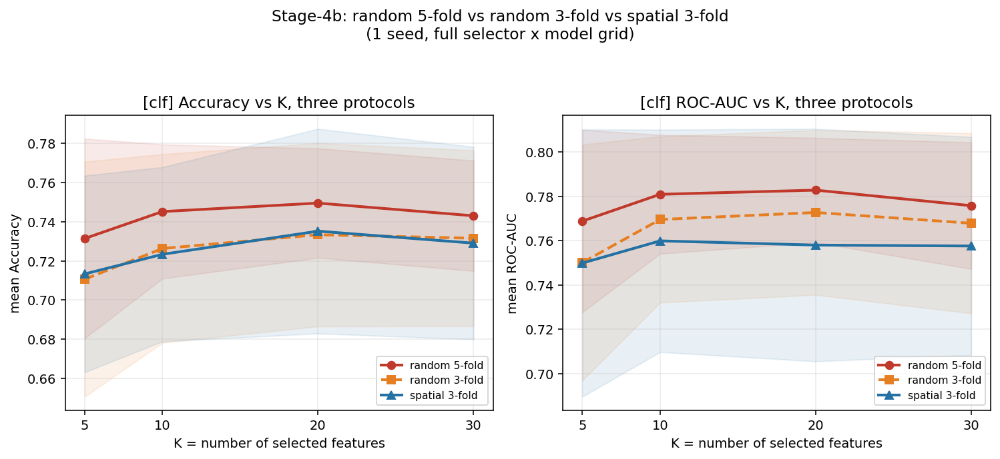
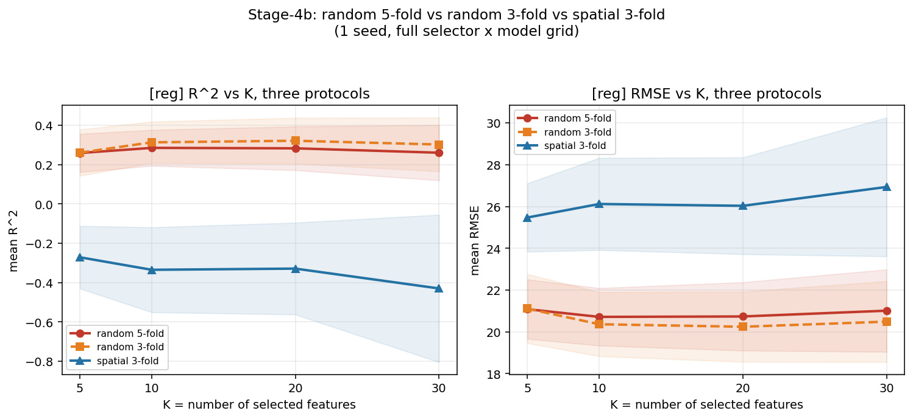
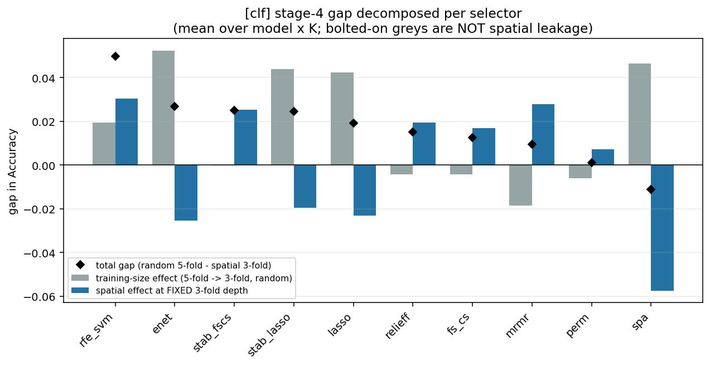
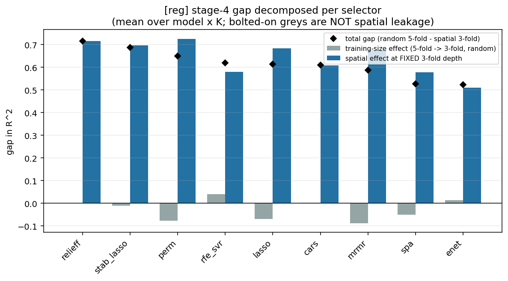

# 选择器动物园 · 阶段④b：3 折随机折对照

> **一句话结论**：阶段④ 那个「随机折 vs 空间折」的 gap，被这一轮拆成了两半——
> **分类的 +0.0171 里，99% 是"5 折变 3 折"（训练量变少），空间本身只贡献 +0.0002（p=0.54，等于零）；
> 回归的 +0.6131 里，训练量贡献 −0.0275（甚至是负的），空间贡献 +0.6407（360/360 全为正）。**
> 换句话说：**分类的随机折数字并没有被空间泄漏污染；回归的崩塌则完全是空间造成的。**

---

## 0. 为什么要做这一步（问题从哪来）

阶段④（空间块 CV）里，我用的两个协议是这样的：

| 协议 | 折数 | 每折训练集占比 |
|---|---|---|
| `A_random`（项目原有的随机折） | **5 折** | ≈ 80% |
| `B_spatial`（空间块折） | **3 折** | ≈ 67% |

问题在于：这两个协议**同时变了两个东西**——①「折怎么切」（随机 → 按空间块），②「切几折」（5 → 3）。
于是 `gap = A_random − B_spatial` 里混进了 **"训练数据变少导致的掉分"**，不全是空间泄漏。

这在两个任务上的严重程度完全不同：

- **回归**：gap = +0.6131。R² 从 0.28 掉到 −0.33，这种量级的崩塌不可能由"训练集从 80% 变 67%"解释 → 混杂可以忽略。
- **分类**：gap = +0.0171。而"稍微少一点训练数据"完全可能造成 1~2 个百分点的波动 → **混杂与主效应同量级，结论不可信**。

所以必须补一个**只有折数不同**的对照。这就是阶段④b。

---

## 1. 设计：三条协议，训练量严格对齐

新增第三条协议：

```python
# src/run_selector_zoo.py --stage4b
StratifiedKFold(n_splits=3, shuffle=True, random_state=42)
```

- 分类轨：在全部 **132 行**上分层（保持 72 健康 / 60 患病的比例）
- 回归轨：与空间折**同样**在 `DI>0` 的 **116 行**子集上重建，并且同样按 0/1 标签分层
  （这样两条 3 折协议连"分层目标"都一致，只有"随机 vs 按块"这一个差别）

**关键：训练量对得几乎一模一样**（这是这个对照能成立的全部理由）：

| 轨道 | 随机 3 折（④b） | 空间 3 折（④） | 是否对齐 |
|---|---|---|---|
| 分类 | 88 / 88 / 88（均值 **88.0**） | 79 / 100 / 85（均值 **88.0**） | ✅ 均值完全相同 |
| 回归 | 77 / 77 / 78（均值 **77.3**） | 85 / 71 / 76（均值 **77.3**） | ✅ 均值完全相同 |

> 折设计审计（`outputs/fold_design_stage4b.csv`）：
> `clf: 44/44/44，每折 24 健康 + 20 患病`；`reg: 39/39/38，每折 19-20 健康 + 20 患病`。

于是原来的一个 gap 可以**精确地**拆成两项（有恒等式保证，见下面的 identity check）：

```
total_gap   = A_random5 − B_spatial          ← 阶段④ 报的那个数
depth_gap   = A_random5 − A_random3          ← 纯"折数/训练量"效应
spatial_gap = A_random3 − B_spatial          ← ★ 固定折数下的空间效应（诚实数字）

total_gap = depth_gap + spatial_gap
```

模型种子（42）与分区种子（42）都与阶段④一致，**唯一变量就是"折怎么切"**。

---

## 2. 核心结果

### 2.1 主结论：gap 的两半

| | 分类（Accuracy） | 回归（R²） |
|---|---|---|
| **total gap**（r5 − sp） | **+0.0171** (p<1e-4) | **+0.6131** (p<1e-4) |
| **depth gap**（r5 − r3）＝ 训练量效应 | **+0.0168** (p<1e-4，63.9% 为正) | **−0.0275** (p=1.00，31.9% 为正) |
| **spatial gap**（r3 − sp）＝ 空间效应 | **+0.0002** (p=0.540，50.2% 为正) | **+0.6407** (p<1e-4，**100.0% 为正**) |
| 恒等式残差 max\|total−depth−spatial\| | 0.00e+00 ✅ | 2.22e-16 ✅ |

**怎么读这张表**：

- **分类**：`depth_gap = +0.0168` ≈ `total_gap = +0.0171`，而 `spatial_gap = +0.0002`。
  → **阶段④ 报的分类 gap，基本上全部是"折数变少"**。把折数固定成 3 之后，随机折与空间折的表现**没有差别**（50.2% 为正 = 抛硬币）。
  → 也就是说：**在本实验的网格上，分类任务的随机折数字没有可检出的空间泄漏。**
- **回归**：`depth_gap = −0.0275`（负！），`spatial_gap = +0.6407`，且 **360 个组合 100% 为正**。
  → **训练量效应不存在（甚至反向）**，阶段④ 的 gap **100% 是空间造成的**。
  → 阶段④ 关于回归的结论**被完整坐实**，而且更强了。

### 2.2 图：三条协议叠在一起看





左图分类（Accuracy）：红（随机 5 折）在上面，**橙（随机 3 折）与蓝（空间 3 折）几乎完全重合**。
右图回归（R²）：红与橙（两条随机折）几乎重合在 0.26~0.32，**蓝（空间折）孤零零地躺在 −0.27~−0.43**。

这就是上面那张表最直白的可视化——**分类的差距出在"橙 vs 红"，回归的差距出在"蓝 vs 橙"**。

### 2.3 逐选择器分解





- 分类图：**灰柱（训练量效应）高度 ≈ 黑菱形（总 gap）**；蓝柱（空间效应）有正有负、量级很小。
- 回归图：**灰柱几乎看不见（甚至为负）**；**蓝柱高度 ≈ 黑菱形**。

### 2.4 差中差校正后（扣掉 `random` 自己的协议效应）

`random` 选择器（随机抽 K 个特征，完全不含任何方法）也会有 gap——那部分是纯协议的。扣掉它：

| 分类 · 超额 spatial gap | | 回归 · 超额 spatial gap | |
|---|---|---|---|
| `rfe_svm` | **+0.0289**（最乐观） | `perm` | +0.0945 |
| `mrmr` | +0.0264 | `relieff` | **+0.0854** |
| `stab_fscs` | +0.0237 | `stab_lasso` | +0.0668 |
| `relieff` | +0.0178 | `lasso` | +0.0523 |
| `fs_cs` | +0.0153 | `mrmr` | +0.0448 |
| `perm` | +0.0056 | `cars` | −0.0224 |
| `random` | 0（基线） | `rfe_svr` | −0.0512 |
| `stab_lasso` / `lasso` / `enet` | −0.021 ~ −0.027 | `spa` | −0.0523 |
| `spa` | **−0.0591**（最"干净"） | `enet` | **−0.1218** |

- 分类侧：**没有哪个选择器的超额空间泄漏大到值得当结论**（最大 `rfe_svm` +0.029，也就是 1 个样本的准确率量级）。
- 回归侧：`relieff` 超额 +0.085 → **它在随机折上的第一名确实含泄漏**（与阶段④ 的 +0.1209 方向一致，量级更小）。

### 2.5 按模型看：谁最怕空间

**回归（spatial gap，越大越怕）**：

`Ridge +0.878` > `PLSR +0.832` > `ENet +0.751` > `KNN +0.642` > `ET +0.589` > `GPR +0.582` > `XGB +0.555` > `RF +0.552` > **`SVR +0.384`（最不怕）**

与阶段④ 完全一致：**全局线性模型（Ridge / PLSR / ENet）最怕空间外推，树模型与 SVR 相对稳**。
这支撑了那条解释——**"全局拟合"能力在跨区域外推时反而是负担**。

**分类（spatial gap）**：所有模型都在 **±0.02** 以内（`SVM +0.019` 最高、`LDA −0.018` 最低）→ 再次印证分类侧没有空间信号。

### 2.6 按 K 看

| K | 分类 depth gap | 分类 spatial gap | 回归 spatial gap |
|---|---|---|---|
| 5 | +0.0208 | −0.0027 | +0.5320 |
| 10 | +0.0189 | +0.0030 | +0.6483 |
| 20 | +0.0162 | −0.0018 | +0.6503 |
| 30 | +0.0115 | +0.0025 | **+0.7320** |

- 分类：depth gap **随 K 单调下降**（+0.021 → +0.011）——特征多一些，模型对训练量的敏感度就低一点；spatial gap 始终在 0 附近摆动。
- 回归：**spatial gap 随 K 单调上升**（+0.53 → +0.73）——**特征越多，跨区域越糟**。
  这与阶段②（PLSR/Ridge 随 K 暴跌）和 FS-CS 实验（"gap 随特征集规模单调上升"）**三处互相印证**。

---

## 3. ⚠️ 一个看似矛盾的地方（必须解释）

P0-② 曾给出「分类 LR 的 gap = **+0.124**」，而这里阶段④/④b 的分类 gap 只有 +0.017。
差了 7 倍。**它们不矛盾，原因是特征集规模不同**：

| | P0-②（`spatial_group_cv.py`） | 阶段④/④b（选择器动物园） |
|---|---|---|
| 特征集 | 固定的大特征集（上百维） | **每个组合先做特征选择，K ≤ 30** |
| 分类 gap | +0.124 | +0.017 |

模型容量（这里＝喂进去的特征数）越大，越有能力"记住"训练区域 → 跨区域掉得越狠。
这与 FS-CS 实验里那条 **"gap 随特征集规模单调上升（2 特征 ≈ 0；117 特征 ≈ 0.06~0.10）"** 完全同向。

**所以正确的表述不是"分类任务没有空间泄漏"，而是**：
> 在 **K ≤ 30 的降维空间**里，分类任务测不出空间泄漏；只有把上百维原始特征直接喂给模型时，泄漏才显现出来。

---

## 4. 对已有结论的修正

1. **分类「存在显著空间泄漏」→ 降级**。
   原话（阶段④ README 局限 1）是分类 gap "可能与训练量差异同量级"。现在证明：**它就是训练量差异，空间贡献为零**。
2. **分类「选择器排名基本保持（Spearman +0.745, p=0.008）」→ 必须降级**。
   把折数固定成 3 之后，随机 3 折 vs 空间 3 折的秩相关只有 **+0.400 (p=0.223)**，不再显著。
   两个数字差这么多，说明**用 11 个选择器算秩相关，置信区间极宽**，这个指标本身就不该被当成证据。
   （回归侧两个口径一致地"低"：+0.236 → +0.115，都指向"排名不稳定"。）
3. **回归的全部结论（崩塌、排名洗牌、最优 K 移向小 K）→ 加强**。
   因为现在能证明训练量混杂在回归上可以忽略（−0.028，方向还是反的）。

---

## 5. 局限（照旧要说清）

1. **回归的 depth gap 不纯粹**：阶段②的回归折是**普通 `KFold(5)`（无分层）**，而阶段④b 为了对齐空间折用了 **`StratifiedKFold(3)`**。
   所以 r5 → r3 的差里同时含"折数"和"是否分层"两个变化。
   → 但这对主结论**无影响**：`spatial_gap` 是 `A_random3` vs `B_spatial` 两者**都分层、都 3 折**，是严格的单变量对照。
2. **单分区种子（42）、单模型种子（42）、超参全未调**：与阶段②④ 相同的限制。
3. **配对单位不独立**（同一折内多个选择器/模型共用样本）+ **未做多重比较校正** → 本文的 p 值**只作方向性提示**。
4. **Winner's curse**：从 440 / 360 个组合里挑"最佳"必然高估，只能当假设。
5. **全程未读 `test_locked.csv`**（33 行封存测试集）。

---

## 6. 产出与复现

| 文件 | 内容 |
|---|---|
| `protocol3_by_combo_{clf,reg}.csv` | 每个 (选择器, 模型, K) 的三协议均值 + 两个 gap + 恒等式残差 |
| `decomposition_by_selector_{clf,reg}.csv` | 含**超额 gap**（扣掉 `random`）的选择器级分解 |
| `protocol3_by_model_{clf,reg}.csv` | 按模型聚合 |
| `protocol3_by_k_{clf,reg}.csv` | 按 K 聚合 |
| `ranking_shift_random3_vs_spatial_{clf,reg}.csv` | 固定 3 折下的排名迁移 |
| `fig1_k_curve_*.png` | 三条协议 vs K |
| `fig2_decomposition_*.png` | 训练量效应 vs 空间效应（逐选择器） |
| `fig3_rank_scatter_*.png` | 固定 3 折下的排名散点 |

```bash
cd project_v2
python -u src/run_selector_zoo.py --stage4b        # 5 min（分类 153 s + 回归 292 s）
python -u src/analyze_stage4b_protocol.py          # 出表 + 出图 + 打印关键数
```

输入是 `experiments/2026-10-12_selector_zoo/outputs/` 下的 `*_per_fold_stage2.csv`（随机 5 折）、
`*_per_fold_stage4b.csv`（随机 3 折）、`*_per_fold_stage4.csv`（空间 3 折）。

---

## 📚 本轮可自学知识点

| 术语 | 一句话解释 |
|---|---|
| **混杂因素（confounder）** | 跟着自变量一起变的第三个变量，会让因果解释出错。这里的"训练量"就是 |
| **对照实验 / 控制变量（controlled contrast）** | 一次只改一个条件。④b 的全部意义就是把"折数"固定住 |
| **差分中的差分（difference-in-differences）** | 先各自算变化，再相减，把公共成分消掉。`超额 gap = gap − gap(random)` 就是 |
| **分层抽样（stratification）** | 分折时保持每折的类别比例。`StratifiedKFold` 的名字来源 |
| **学习曲线（learning curve）** | 性能 vs 训练集大小的曲线。分类 depth gap 就是它的一个斜率 |
| **秩相关（Spearman's ρ）** | 比较两组排名是否一致；样本少时置信区间极宽，别当硬证据 |
| **模型容量（capacity）** | 模型能记住多少东西。特征越多、模型越"贵"，越容易记住训练区域 |
| **外推（extrapolation）** | 在训练分布之外的区域做预测；空间块折本质上就是逼模型外推 |
