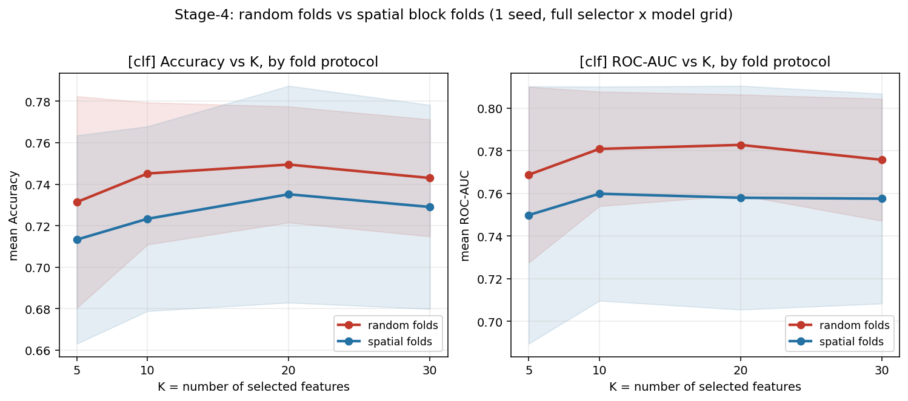
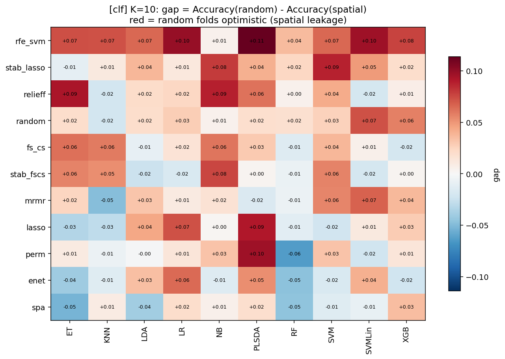
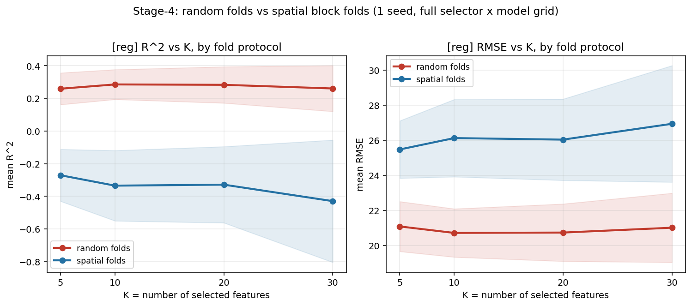
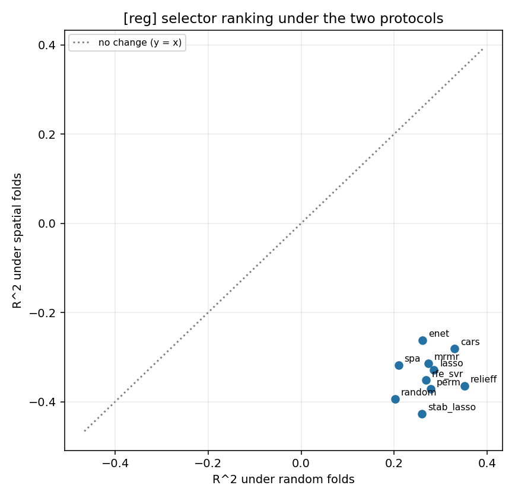

# 阶段④ —— 空间块交叉验证（spatial block CV）下的「选择器 × 模型」矩阵

> ⚠️ **探索性结果，不进论文/竞赛作品**。单一分区种子（42）、单一模型种子（42）、超参全未调。
> 结论要等「确认阶段」用多分区种子 + 配对检验 + 多重比较校正复核后才能引用。
> 全程 **未读取** `test_locked.csv`。

## 这是什么

阶段①②是在**随机折（random folds）**上做的。阶段④把**同一个网格**（同样的 11/10 个选择器 ×
10/9 个模型 × K=5/10/20/30）搬到**空间块折（spatial block folds）**上重跑一遍，
唯二的变化是「折怎么切」——模型种子完全相同。

**为什么要这么做**：本项目的样本在空间上高度共址（最近邻距离中位数仅 ≈45 m，149/165 个样本
在 110 m 内就有邻居），而地理位置与病害状态**强相关**（已发现既有全健康空间块、也有全患病空间块）。
随机折会把同一田块的样本同时放进训练和验证 → 模型可以靠"记住这片区域"过关，
分数被**空间泄漏（spatial leakage）**抬高。空间块折强制"整块留出"，是唯一的诚实性检验。

### 折协议（stage 4）

| 项 | A_random（阶段②，作为对照） | B_spatial（阶段④） |
|---|---|---|
| 划分方式 | 按行随机分层 | KMeans(10) 聚经纬度 → 整块留出 |
| 折数 | 5 | **3**（10 块切 5 折会出现 2 样本废折） |
| 折生成 | `data/cv/classification_folds.csv`（StratifiedKFold(5, seed=42)） | `StratifiedGroupKFold(3, shuffle, seed=42)` |
| 回归折 | `data/cv/regression_folds.csv`（KFold(5, seed=42)，DI>0 子集） | 在 DI>0 的 116 行上**重建**块与折 |
| 训练行数（分类） | 105 / 105 / 106 / 106 / 106 | **79 / 100 / 85** |
| 训练行数（回归） | 92 / 93 / 93 / 93 / 93 | **85 / 71 / 76** |

折构造刻意与 `src/spatial_group_cv.py`（P0-②）**完全一致**（同一 KMeans 参数、同一 seed），
所以两次实验用的是**同一套空间分区**，数字可以并排读。

### 折设计审计（脚本原样输出，先看它再信数字）

```
task  fold  n_val  n_healthy  n_diseased  n_blocks
 clf     0     53         23          30         4
 clf     1     32         19          13         3
 clf     2     47         30          17         3
 reg     0     31          8          23         3
 reg     1     45         26          19         3
 reg     2     40         22          18         4
```

另经独立核对：**没有任何一个空间块被切开分到两个折**（clf / reg 均为 0 块跨折）→ 分组正确。

### 规模与耗时

| 轨 | 网格 | 行数 | 耗时 |
|---|---|---|---|
| 分类 | 3 折 ×（11 选择器 × 10 模型 × 4 个 K） | 1320 | 160 s |
| 回归 | 3 折 ×（10 选择器 × 9 模型 × 4 个 K） | 1080 | 302 s |
| **合计** | | **2400** | **302 s（5 分 10 秒）** |

---

## ★ 结论一：分类 —— 空间折只掉"一点点"，且结论基本不变

> 🔴 **2026-10-13 归因修正（由阶段④b 完成）**：这一节说的"空间折掉分"其实主要是**折数效应**。
> 补了「3 折随机折」对照后证实：分类的 +0.0171 gap 里 **+0.0168 来自"5 折 → 3 折"（训练量变少）**，
> 真正的空间效应只有 **+0.0002（p=0.54，440 组合 50.2% 为正）**。
> 本节下面的数字**仍然全部有效**（它们就是 total gap），但**归因要改**：
> 在 K ≤ 30 的降维空间里，**分类的随机折数字没有可检出的空间泄漏**。
> 详见 `results/selector_zoo_protocol/README.md`。

```
===== clf | metric=accuracy | combos=440 | gap>0 in 278/440 (63.2%) =====
  overall mean gap  = +0.0171
  Spearman(rank_random, rank_spatial) = +0.745 (p=0.008)
```

| 层面 | 观察 |
|---|---|
| 整体 | 平均 gap 仅 **+0.0171**；440 个组合里 63.2% 为正。单折准确率的最小刻度是 1/26 ≈ 0.038，**这个缺口不到半个样本** |
| 选择器排名 | Spearman **+0.745 (p=0.008)** → 排名**基本保持**；`relieff` 在空间折下仍是第一（0.7581）<br>🔴 **④b 修正**：固定 3 折后只剩 **+0.400 (p=0.223)** → 该指标不宜当证据（11 个点的秩相关置信区间极宽） |
| 模型排名 | `RF` 的 gap = **−0.0017**（几乎不掉分）；掉得最多的是 `SVMLin` +0.0384、`PLSDA` +0.0280、`SVM` +0.0273、`LR` +0.0262 |
| K 的关系 | gap 在 K=10 最大（+0.0218）、K=30 最小（+0.0140）→ 缺口不随特征数放大<br>🔴 **④b 修正**：这个"随 K 下降"**是折数效应**（depth gap +0.0208 → +0.0115），空间项始终 ≈ 0 |





## ★★ 结论二：回归 —— 空间折下**全面崩塌**

```
===== reg | metric=r2 | combos=360 | gap>0 in 360/360 (100.0%) =====
  overall mean gap  = +0.6131
  Spearman(rank_random, rank_spatial) = +0.236 (p=0.511)
```

- **360 个组合，100% 都是 gap > 0**，平均高达 **+0.61 R²**。空间折下 R² 几乎全部为负
  （K=30 时平均 −0.43）。
- 选择器排名被**完全洗牌**：Spearman 只有 +0.236 且 p=0.511（与随机排名无法区分）。
  随机折第一名 `relieff` 在空间折掉到**第 7**；随机折排第 7 的 `enet` 反而成**第一**。
- 也就是说：**随机折给出的"哪个选择器最好"这个排名，在回归上完全不可迁移。**
- 对照 RMSE：随机折 ~21，空间折 ~26（平均高 4–7 个严重度单位）。





> 右图（ranking shift）里 10 个选择器全部挤在右下角、离 `y = x` 虚线极远：
> 这就是"随机折排名不作数"的画面化表达。

---

## ★ 结论三：差中差校正 —— 谁的优势是"真"的？

`random` 选择器**不含任何方法**，但它从随机折换到空间折也会掉分。
（原文把原因写成"训练数据变少、任务变难"——**④b 证明只有前半句对**：
把折数固定成 3 之后，空间本身没有让任务变难，掉分几乎全部来自**训练量变少**。）
所以「gap」本身不全是泄漏，**gap − gap(random) 才是选择器自身带来的那部分**：

| 分类（accuracy） | gap | 超额 gap | | 回归（R²） | gap | 超额 gap |
|---|---|---|---|---|---|---|
| `random`（基准） | +0.0156 | **0** | | `random`（基准） | +0.5954 | **0** |
| `rfe_svm` | +0.0497 | **+0.0341** | | `relieff` | +0.7163 | **+0.1209** |
| `enet` | +0.0269 | +0.0112 | | `stab_lasso` | +0.6870 | +0.0915 |
| `stab_fscs` | +0.0250 | +0.0094 | | `perm` | +0.6492 | +0.0538 |
| `stab_lasso` | +0.0244 | +0.0088 | | `rfe_svr` | +0.6201 | +0.0247 |
| `lasso` | +0.0191 | +0.0035 | | `lasso` | +0.6140 | +0.0186 |
| **`relieff`** | +0.0150 | **−0.0006** | | `cars` | +0.6105 | +0.0150 |
| `fs_cs` | +0.0125 | −0.0032 | | `mrmr` | +0.5878 | −0.0077 |
| `mrmr` | +0.0094 | −0.0062 | | `spa` | +0.5278 | −0.0676 |
| `perm` | +0.0010 | −0.0146 | | `enet` | +0.5230 | −0.0725 |
| `spa` | −0.0111 | −0.0267 | | | | |

**两条最重要的读法**：

1. **分类里 `relieff` 的超额 gap ≈ 0（−0.0006）** —— 它在阶段① 表现出的优势
   **不是空间泄漏造出来的**，是真的。`rfe_svm` 相反：随机折数字最乐观（超额 +0.0341）。
   > 🔴 **④b 修正**：这个 −0.0006 其实是**两项抵消**的结果 —— `relieff` 的超额**折数**效应 = **−0.0184**
   > （它比 `random` 更抗"训练量减少"）＋ 超额**空间**效应 = **+0.0178**（它比 `random` 掉得更多），两者相加 ≈ 0。
   > 换成 ROC-AUC 口径，它的超额空间效应是 **−0.0007**（≈ 0）。两个口径一正一负 → 量级就在噪声里
   > （单折准确率最小刻度 1/26 ≈ 0.038）。
   > **结论"`relieff` 的优势是真的、不是泄漏"仍然成立**，只是要补上这个更细的分解。
2. **回归里 `relieff` 的超额 gap 最大（+0.1209）** —— 它的随机折领先里
   **确有一部分是空间泄漏**，所以它的"第一名"在空间折下不保（掉到第 7）。
   不过它仍高于 `random` 自己（−0.365 vs −0.393），说明信号没被完全抹掉。

> 负的超额 gap（分类的 `spa`、回归的 `enet`）表示该选择器在空间折下反而更好——小样本波动，
> 不必过度解读，但也要如实记录。

---

## ★ 结论四：空间折下，"最优 K"会不会变？

| | 随机折（阶段②） | 空间折（阶段④） | 结论 |
|---|---|---|---|
| 分类 accuracy | 0.7314 / 0.7452 / **0.7495** / 0.7430（K=5/10/20/30） | 0.7133 / 0.7233 / **0.7352** / 0.7290 | **最优档不变，都是 K=20** |
| 回归 R² | 0.2590 / **0.2853** / 0.2829 / 0.2606 | **−0.2712** / −0.3349 / −0.3288 / −0.4298 | **向小 K 移动：K=5 最好（最不差）** |

- 分类：形状一模一样（先升后降，峰值 K=20），只是整体下移。→ **特征集规模的选择是稳的**。
- 回归：空间折下**特征越多越糟**，K=30 最差。这与既有发现一致——
  「**模型越"贵" / 特征越多，跨区域越不稳**」（`current_2` 两特征方案与 FS-CS 的发现）。

## ★ 结论五：谁最"怕空间"？

| 分类模型 | gap | | 回归模型 | gap |
|---|---|---|---|---|
| `SVMLin` | +0.0384 | | `Ridge` | **+0.8373** |
| `PLSDA` | +0.0280 | | `PLSR` | **+0.7907** |
| `SVM` | +0.0273 | | `ENet` | +0.7128 |
| `LR` | +0.0262 | | `KNN` | +0.5973 |
| `LDA` | +0.0141 | | `ET` | +0.5649 |
| `ET` | +0.0136 | | `XGB` | +0.5517 |
| `XGB` | +0.0101 | | `GPR` | +0.5434 |
| `KNN` | +0.0083 | | `RF` | +0.5324 |
| `NB` | +0.0062 | | `SVR` | +0.3875 |
| `RF` | **−0.0017** | | | |

- **全局线性模型（Ridge / PLSR / ENet）最怕空间**，与 P0-② 的方向一致
  （P0-② 的 Ridge gap +1.554，那是在不同预处理、不同评估口径下算的）。
  树模型（ET / RF）最稳，`RF` 在分类上甚至没掉分。
- 一句话：**在小样本 + 空间外推的场景里，线性模型的"全局拟合"能力反而是负担。**

---

## ⚠️ 四个必须说清的局限

1. ~~**协议不对称（最重要的混杂）**：随机折是 5 折（训练 ~80% 行），空间折是 3 折（训练 ~67% 行）。
   所以 gap 里**混入了"训练数据变少"**这一部分，不全是空间泄漏。
   → 这在回归上影响可忽略（gap 高达 0.61），但在分类上（gap 仅 0.017）**可能与训练量差异同量级**。
   → **待办（阶段④b）：补一个"3 折随机折"对照**，把折数固定为 3，才能把两者剥离。~~
   → ✅ **已于 2026-10-13 由阶段④b 解决，见 `results/selector_zoo_protocol/`。结论被修正**：
   - **回归**：训练量效应 = **−0.0275**（方向还相反），空间效应 = **+0.6407（360/360 全为正）**
     → 本页回归的全部结论**被坐实并加强**（gap 100% 来自空间）。
   - **分类**：训练量效应 = **+0.0168**（≈ 总 gap），空间效应 = **+0.0002（p=0.54，50.2% 为正）**
     → ⚠️ **本页"分类存在空间泄漏"的说法必须降级**：那 +0.0171 基本全是"5 折变 3 折"，
     在 K ≤ 30 的降维空间里，空间本身贡献 ≈ 0。
   - ⚠️ 连带修正：本页的「分类选择器排名基本保持（Spearman +0.745, p=0.008）」在固定 3 折后
     只剩 **+0.400 (p=0.223)** —— 用 11 个选择器算秩相关置信区间过宽，该指标不宜当证据。
2. **只有一个空间分区种子（42）**：KMeans 换个种子，分块就变，结论可能变。
   本阶段为了与阶段②严格同种子配对，刻意只跑一个分区。重复分区属**确认阶段**工作。
3. **Winner's curse（赢家诅咒）**：从 440 / 360 个组合里挑"最佳组合"**必然高估**。
   目前空间折下唯一 R² 为正的格子是 `mrmr + ENet/Ridge/PLSR @ K=5`（≈ +0.10）——
   这**只能当假设**，必须在确认阶段独立验证，不能写进结论。
4. **配对单位不独立 + 单 seed + 超参未调 + 未读 test_locked**：与阶段①②相同的限制。
   本目录的 p 值**只作方向性提示**，没有做多重比较校正（那是确认阶段的事）。

---

## 产出文件

| 文件 | 内容 |
|---|---|
| `gap_by_combo_{clf,reg}.csv` | 每个 (选择器, 模型, K) 的 random / spatial / gap（440、360 行） |
| `gap_by_selector_{clf,reg}.csv` | 含**超额 gap（差中差）**列 |
| `gap_by_model_{clf,reg}.csv` | 按模型聚合 |
| `gap_by_k_{clf,reg}.csv` | 按 K 聚合 |
| `leaderboard_spatial_{clf,reg}.csv` | 空间折下的绝对排名 |
| `ranking_shift_{clf,reg}.csv` | 选择器在两协议下的均值 + 排名移动 |
| `fig1/fig2_protocol_k_curve_*.png` | 指标 vs K，两协议叠放 |
| `fig3_gap_heatmap_*.png` | 选择器 × 模型 gap 热图（K=10） |
| `fig4_ranking_shift_*.png` | 排名迁移散点（含 y=x 参考线） |

## 复现

```bash
cd project_v2
python -u src/run_selector_zoo.py --stage4        # 空间折全网格，~5 min
python -u src/analyze_stage4_spatial.py           # 出表 + 出图 + 打印关键数
```
